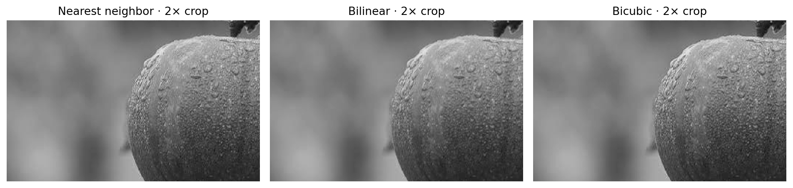
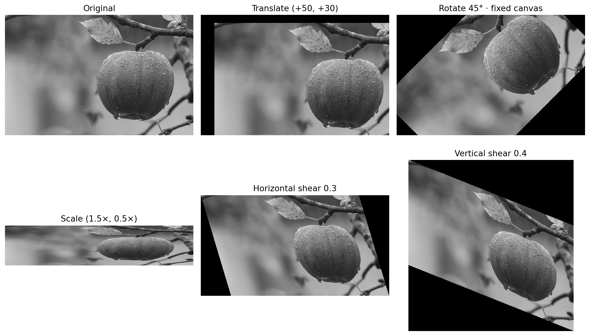
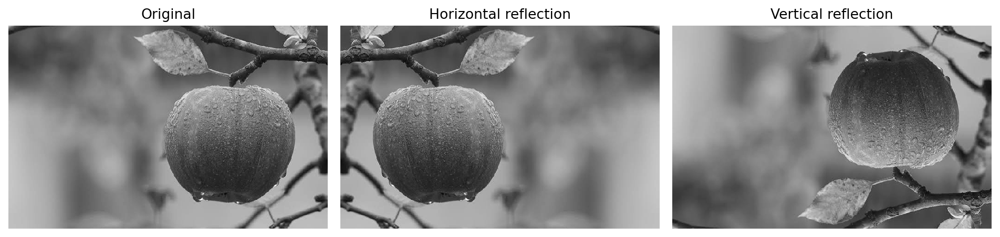

# Image Interpolation and Geometric Transformations

Nine educational image-processing experiments using **Python, OpenCV, NumPy, and Matplotlib**. Compare interpolation methods and explore translation, scaling, identity, rotation, shearing, and reflection.

[View the notebook with saved outputs](image_transformations.ipynb)

## Results at a glance



Nearest neighbor replicates pixels; bilinear blends nearby samples; bicubic uses a larger neighborhood. Smoother or sharper-looking output does not imply recovery of missing scene detail.



Fixed-size canvases demonstrate clipping during translation and rotation. Expanded canvases accommodate the positive shear factors used here.



## Experiments

| Experiment | Parameters / behavior |
|---|---|
| Nearest-neighbor enlargement | 2× width and height |
| Bilinear enlargement | 2× width and height |
| Bicubic enlargement | 2× width and height |
| Translation | 50 pixels right; 30 pixels down |
| Non-uniform scaling | Width ×1.5; height ×0.5 |
| Identity | Exact pixel equality and zero difference |
| Rotation | 45° counterclockwise, fixed canvas |
| Shearing | Horizontal 0.3; vertical 0.4 |
| Reflection | Horizontal and vertical flips |

## Run locally

Extract or clone the complete project. Open a terminal in the folder containing this README.

```bash
python -m pip install -r requirements.txt
python -m pip install jupyterlab
python -m jupyterlab
```

Open `image_transformations.ipynb`, restart the kernel, and run all cells in order. The notebook exports its three showcase PNGs into `images/`.

The headless OpenCV package provides the image-processing operations; plots use Matplotlib, so no OpenCV desktop GUI is required. Avoid installing multiple OpenCV variants in the same environment.

## Input image and provenance

The bundled `data/image.jpg` is the user-supplied JPEG originally uploaded as `image.jpg.jfif`. Its encoded bytes are unchanged; the filename is simplified to match its actual JPEG format. The original creator and license were not supplied; this project does not assert ownership of the photograph or grant a license for it.

The image is 692 × 442 pixels (width × height). OpenCV loads it as grayscale. All saved outputs were regenerated using this image. No external dataset or trained model is needed.

To use another image, place it in `data/`, update `IMAGE_PATH` in the notebook, and run all cells again. Missing or unreadable images produce a clear error.

## Verification

All 13 code cells execute in order in a shared Python namespace. The saved notebook contains 12 result figures, including three exported showcase figures. Notebook structure was validated with nbformat. A separate Jupyter kernel could not start in the verification environment, so execution was performed directly in Python with captured text and plot outputs.

Checks pass for doubled image dimensions, exact identity, zero identity-difference pixels, double reflections, translation output size, and the unchanged retained region after integer translation.

For the bundled image, array shapes are reported as height × width: 442 × 692 input; 884 × 1384 enlargement; 221 × 1038 non-uniform scaling. Identity changes zero pixels.

## Scope and limitations

- Classical image processing, not a trained machine-learning model.
- One demonstration image, not a dataset-wide quality evaluation.
- No claim that bicubic is always superior; it can produce ringing.
- Interpolation estimates intensities and cannot recover unknown original detail.
- Non-uniform scaling changes aspect ratio. Shrinking can alias; area resampling is a useful additional comparison.
- Negative shear factors need output-coordinate translation as well as larger canvases; this notebook demonstrates positive factors.
- No accuracy, runtime ranking, or production-readiness claim.

## Project files

- `image_transformations.ipynb`: commented experiments, explanations, and saved outputs.
- `data/`: supplied image and provenance note.
- `images/`: three figures suitable for README and LinkedIn.
- `requirements.txt`: verified analysis package versions.

## Reference

[OpenCV: Geometric Transformations of Images](https://docs.opencv.org/4.x/da/d6e/tutorial_py_geometric_transformations.html)

Verified environment: Python 3.12.14; opencv-python-headless 5.0.0.93, numpy 2.3.5, matplotlib 3.10.8.
